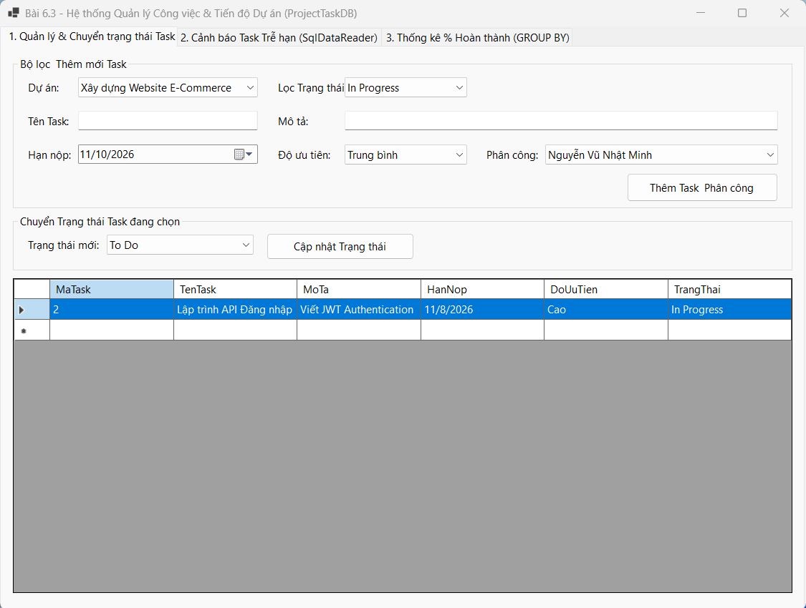
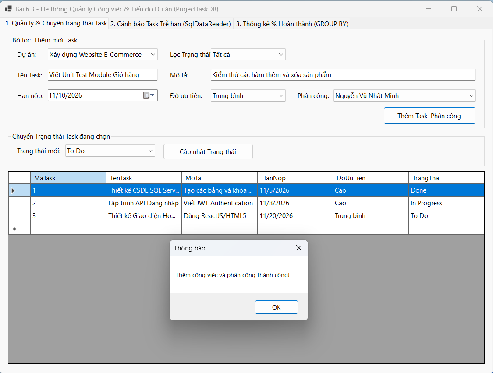
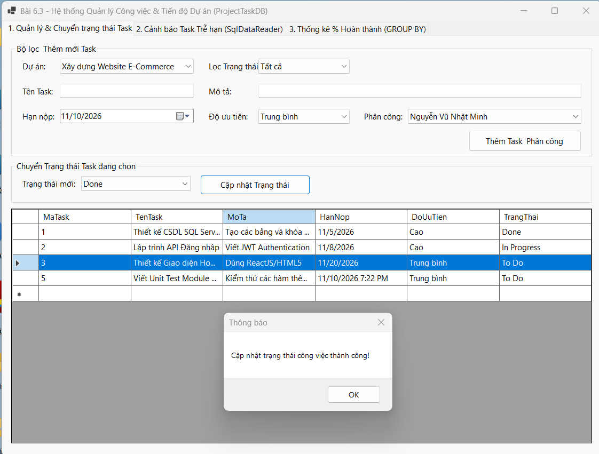
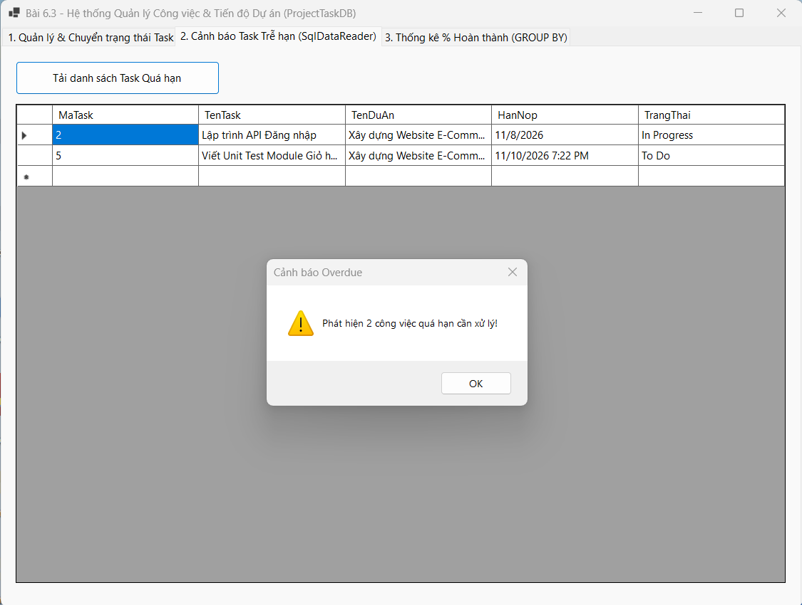
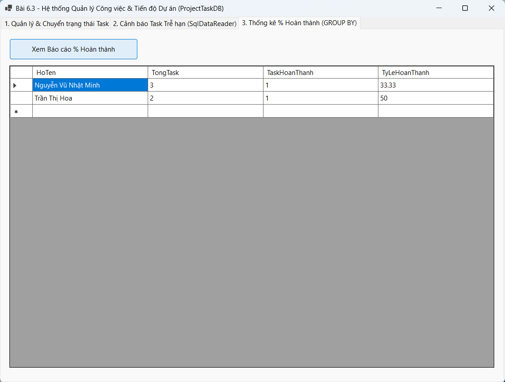
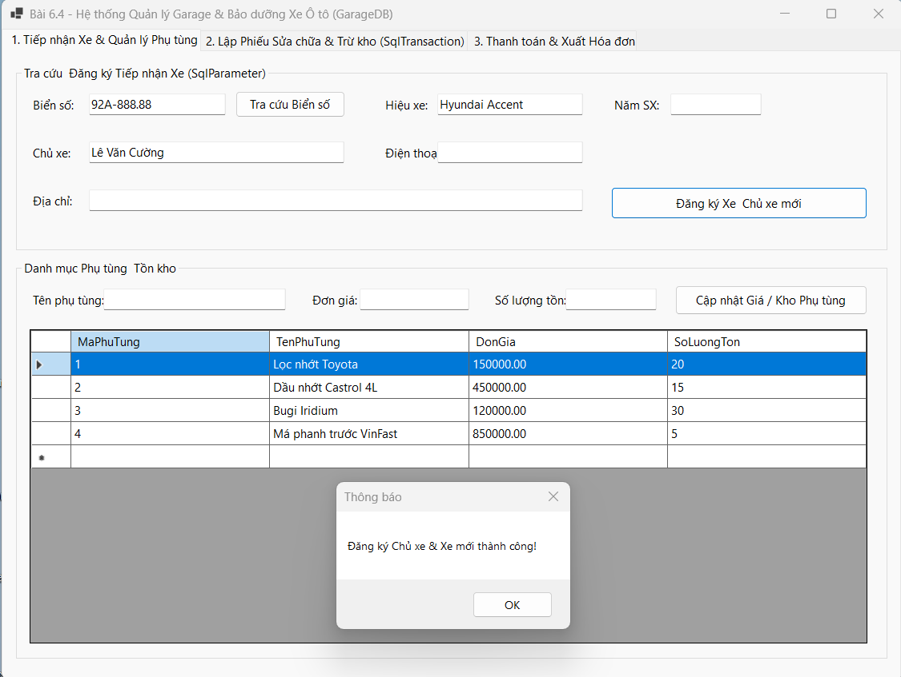
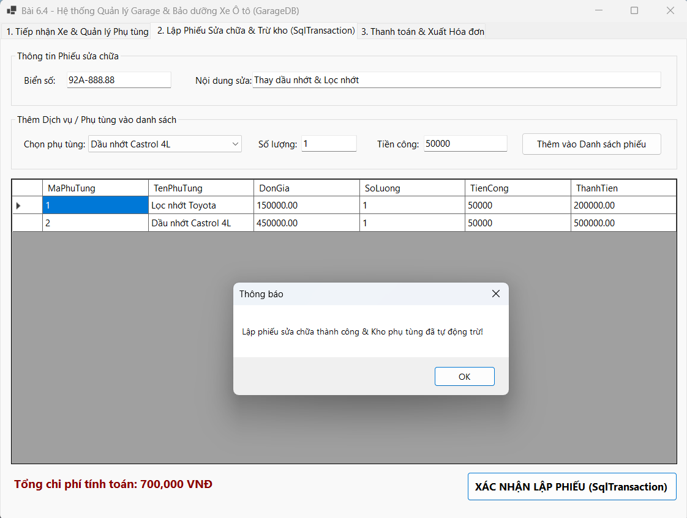
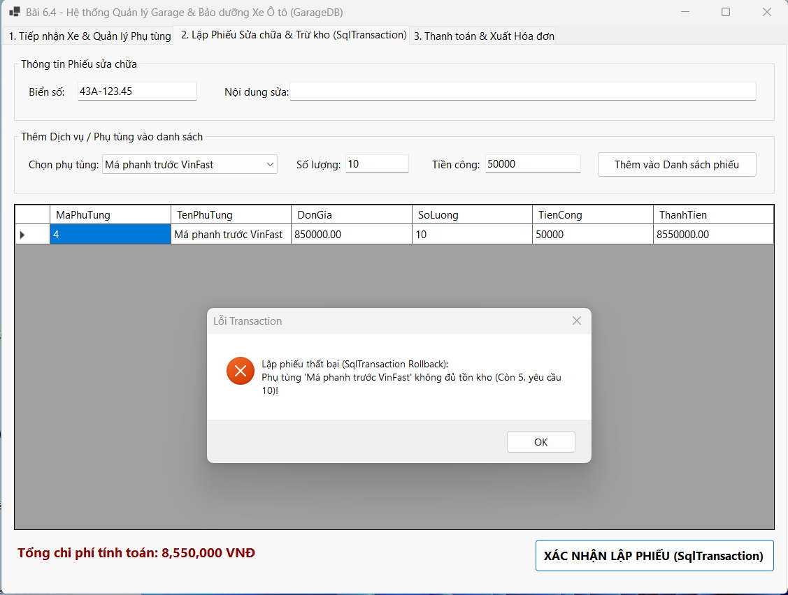
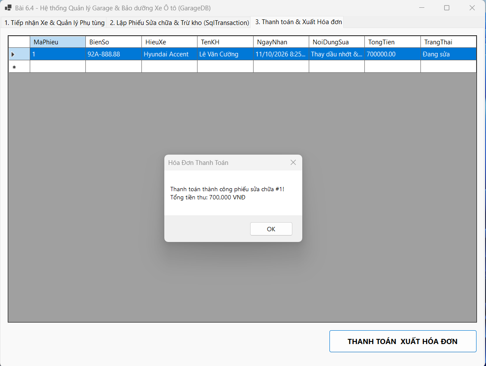

# BÁO CÁO BÀI TẬP THỰC HÀNH CHƯƠNG 6

## MỤC 1: THÔNG TIN SINH VIÊN
- **Họ và tên sinh viên**: Nguyễn Vũ Nhật Minh
- **Mã sinh viên**: 24810320314
- **Lớp**: D19QTANM1

---

## MỤC 2: HÌNH ẢNH KẾT QUẢ CÁC MÀN HÌNH CHỨC NĂNG

### BÀI 6.3: HỆ THỐNG QUẢN LÝ DỰ ÁN & CÔNG VIỆC (PROJECT TASK SYSTEM)

#### 1. Màn hình Chính / Tra cứu & Lọc danh sách Task:

#### 2. Màn hình Quản lý Danh mục (Thêm Task & Phân công):

#### 3. Màn hình Thực thi Nghiệp vụ chính (Cập nhật Trạng thái Task):

#### 4. Màn hình Cảnh báo Trễ hạn (SqlDataReader):

#### 5. Màn hình Báo cáo - Thống kê % Hoàn thành (GROUP BY):

---

### BÀI 6.4: HỆ THỐNG QUẢN LÝ GARAGE & BẢO DƯỠNG XE Ô TÔ (GARAGE MANAGEMENT SYSTEM)

#### 1. Màn hình Chính & Tiếp nhận Xe / Vật tư:

#### 2. Màn hình Thực thi Nghiệp vụ (Lập Phiếu & Trừ kho SqlTransaction):

#### 3. Minh họa An toàn Dữ liệu (Báo lỗi SqlTransaction Rollback khi vượt tồn kho):

#### 4. Màn hình Thanh toán & Xuất Hóa đơn:
