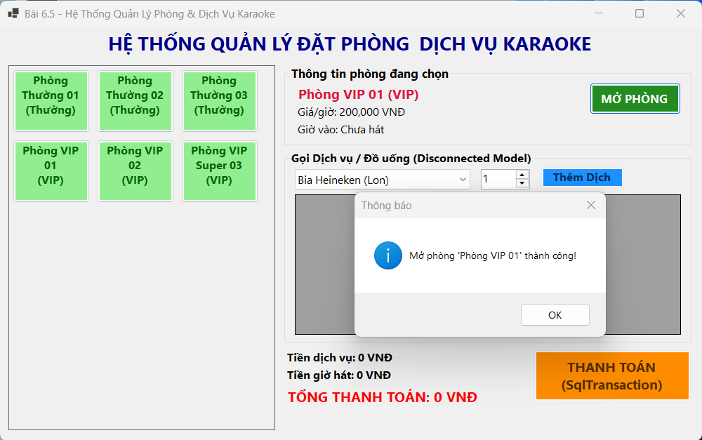
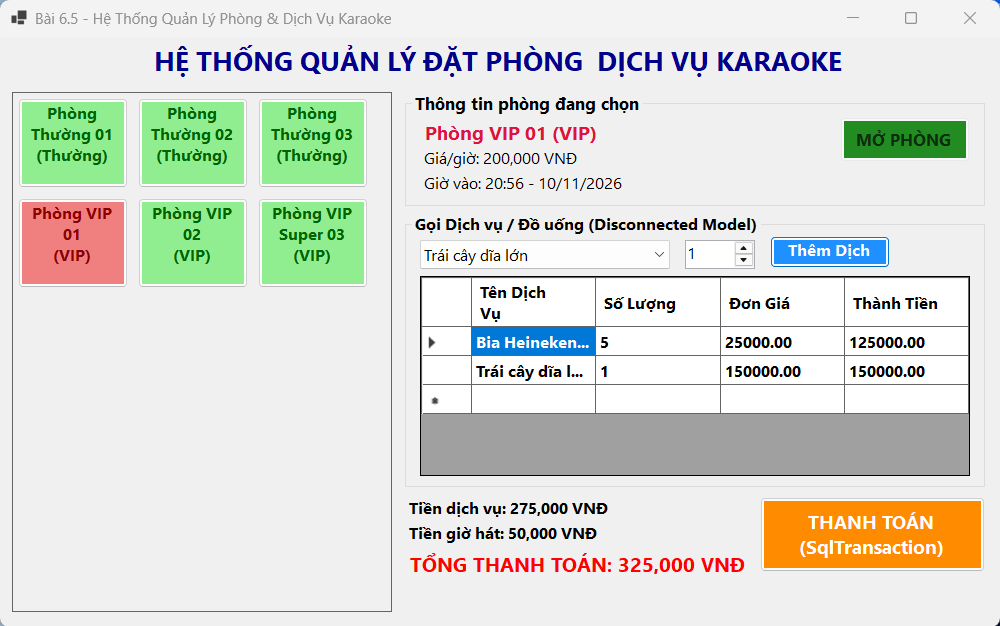
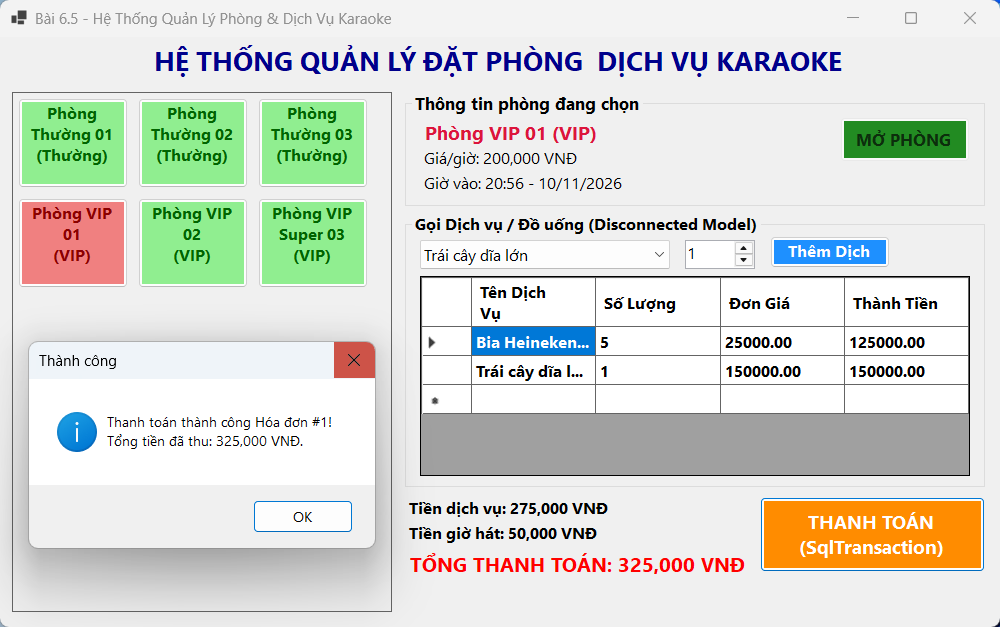
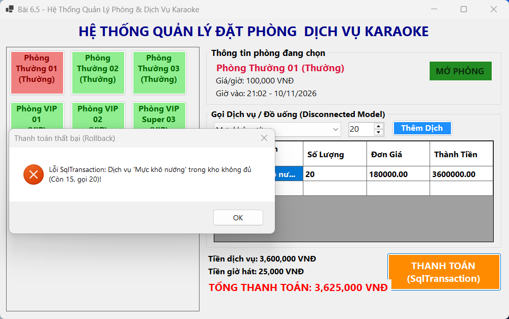

# BÁO CÁO BÀI TẬP THỰC HÀNH CHƯƠNG 6

## MỤC 1: THÔNG TIN SINH VIÊN
- **Họ và tên sinh viên**: Nguyễn Vũ Nhật Minh
- **Mã sinh viên**: 24810320314
- **Lớp**: D19QTANM1

---

## MỤC 2: HÌNH ẢNH KẾT QUẢ CÁC MÀN HÌNH CHỨC NĂNG

### BÀI 6.3: HỆ THỐNG QUẢN LÝ DỰ ÁN & CÔNG VIỆC (PROJECT TASK SYSTEM)

1. Màn hình Chính / Tổng quan hệ thống:

2. Màn hình Quản lý Danh mục (CRUD - Thêm/Sửa/Xóa):

3. Màn hình Thực thi Nghiệp vụ chính (Cập nhật tiến độ Task):

4. Màn hình Báo cáo - Thống kê (% Hoàn thành công việc):

5. Minh họa An toàn Dữ liệu (SqlDataReader Cảnh báo trễ hạn / Parameterized Query):

---

### BÀI 6.4: HỆ THỐNG QUẢN LÝ GARAGE & BẢO DƯỠNG XE Ô TÔ (GARAGE MANAGEMENT SYSTEM)

1. Màn hình Chính / Tổng quan hệ thống:

2. Màn hình Thực thi Nghiệp vụ chính (Lập Phiếu sửa chữa & Trừ kho):

3. Màn hình Báo cáo - Thống kê (Thanh toán & Xuất hóa đơn Garage):

4. Minh họa An toàn Dữ liệu (Báo lỗi Transaction Rollback khi hết phụ tùng):

---

### BÀI 6.5: HỆ THỐNG QUẢN LÝ ĐẶT PHÒNG & DỊCH VỤ KARAOKE (KARAOKE MANAGEMENT SYSTEM)

1. Màn hình Chính / Tổng quan hệ thống (Visual Room Grid Layout & Mở phòng):

2. Màn hình Quản lý Danh mục (Gọi Dịch vụ / Đồ uống - Disconnected Model):

3. Màn hình Thực thi Nghiệp vụ chính (Tính tiền giờ & Thanh toán SqlTransaction):

4. Minh họa An toàn Dữ liệu (Báo lỗi Transaction Rollback khi kho không đủ):
